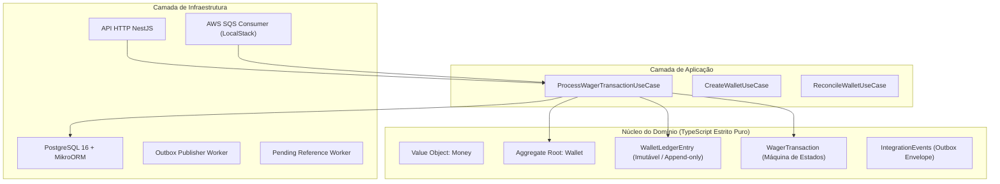

# 🏛️ Architecture & Technical Decision Record (ADR)
## Technical Challenge — Distributed Wagering Processor (Jungle Gaming)

Este documento detalha todas as decisões arquiteturais, justificativas técnicas, trade-offs e estratégias de concorrência e consistência adotadas na construção do **Distributed Wagering Processor**.

---

## 1. Visão Arquitetural & Princípios de Design

A solução foi concebida sob os princípios de **Domain-Driven Design (DDD)**, **Clean Architecture** e **Defesa em Profundidade (*Defense in Depth*)**:



### Princípios Invioláveis Respeitados:
1. **Domínio Puro e Desacoplado:** O pacote `src/domain` contém regras financeiras puras em TypeScript, sem anotações de ORM, decorators do NestJS ou dependências externas pesadas (apenas `decimal.js` para precisão matemática).
2. **Reuso Total do Caso de Uso:** Tanto o endpoint HTTP (`POST /wagering/transactions`) quanto o consumidor de fila SQS reutilizam o mesmíssimo caso de uso (`ProcessWagerTransactionUseCase`), garantindo paridade de comportamento em qualquer canal de entrada.
3. **Atomicidade Contábil:** Saldo materializado (`Wallet`), extrato contábil (`WalletLedgerEntry`), máquina de estados da transação (`WagerTransaction`), deduplicação de mensagens (`InboxMessage`) e eventos de integração (`OutboxMessage`) são confirmados na **mesmíssima transação SQL**.

---

## 2. Decisões Arquiteturais Fundamentais (ADR)

### ADR 01: Value Object `Money` vs Tipos Nativos de Ponto Flutuante
* **Problema:** O JavaScript utiliza IEEE 754 (64-bit floating point). Frações decimais simples geram dízimas binárias (ex: `0.1 + 0.2 === 0.30000000000000004`). Em milhões de apostas, centavos seriam criados ou destruídos do nada.
* **Decisão:** Implementação de um Value Object `Money` imutável, encapsulando a biblioteca `decimal.js`, com escala fixa de 2 casas decimais e serialização padronizada como `string` decimal (`"100.00"`).
* **Regras de Negócio no VO:**
  - Operações entre moedas distintas (`BRL` vs `USD`) lançam `CurrencyMismatchError` imediato.
  - Entradas inválidas (`NaN`, `Infinity`, strings vazias, mais de 2 casas decimais ou valores negativos na entrada) são rejeitadas na factory estática `Money.from()`.

### ADR 02: Concorrência Extrema — Lock Pessimista (`FOR UPDATE`) vs Lock Otimista
* **Problema:** Múltiplas requisições disputando o saldo da mesma carteira no mesmo milissegundo (cenário dos R$ 80 disputando R$ 100 com 3 instâncias em paralelo).
* **Decisão:** Adoção de **Lock Pessimista por Linha (`SELECT ... FOR UPDATE`)** através do `LockMode.PESSIMISTIC_WRITE` do MikroORM.
* **Justificativa do Trade-off:**
  - O *Lock Otimista* (`version`) exige retries sucessivos em memória. Em momentos de pico no iGaming (ex: gols em apostas ao vivo ou giros de alta frequência), dezenas de transações bateriam na mesma versão e falhariam, gerando tempestade de retries e desperdício de CPU.
  - O *Lock Pessimista* serializa a execução **apenas na linha daquela carteira específica (`walletId`)**. Carteiras de jogadores diferentes processam 100% em paralelo. Quem disputa a mesma carteira entra na fila nativa do PostgreSQL. A primeira transação debita e commita; a segunda lê o saldo já reduzido e é rejeitada com segurança por saldo insuficiente.
  - Como a transação é curta e o lock é granular por chave primária, a latência de lock contention é mínima.

### ADR 03: Defesa em Profundidade no Schema do Banco de Dados
* **Problema:** Garantir que erros de programação futuros ou queries manuais nunca corrompam as invariantes contábeis.
* **Decisão:** Aplicação de constraints rígidas no schema PostgreSQL:
  ```sql
  CONSTRAINT check_wallet_balance_not_negative CHECK (balance >= 0)
  CONSTRAINT unique_player_currency UNIQUE (player_id, currency)
  CONSTRAINT unique_idempotency_key UNIQUE (idempotency_key)
  CONSTRAINT unique_provider_external_id UNIQUE (provider_id, external_transaction_id)
  ```
* Se o código TypeScript falhar, o PostgreSQL barra a operação e não permite saldo negativo nem carteiras duplicadas.

### ADR 04: Idempotência com Hash Canônico SHA-256
* **Problema:** Tratar retransmissões idênticas causadas por timeout de rede e detectar tentativas de conflito ou fraude (mesma chave com valores diferentes).
* **Decisão:**
  - O cabeçalho `Idempotency-Key` é a fonte da verdade primária.
  - Um algoritmo recursivo ordena alfabeticamente todas as chaves do payload de negócio, excluindo headers e timestamps de transporte, e gera um hash SHA-256 (`payloadHash`).
  - **Mesma chave + mesmo hash:** Replay idempotente seguro (`idempotentReplay: true`), retornando o saldo e o status originais sem tocar no ledger.
  - **Mesma chave + hash divergente:** Conflito explícito (`409 Conflict`), rejeitado imediatamente via `IdempotencyConflictError`.

### ADR 05: Transactional Outbox Pattern
* **Problema:** O problema da "Escrita Dupla" (*Dual Write*). Se a aplicação gravar no banco e morrer antes de enviar a mensagem ao SQS, o evento é perdido para sempre. Se enviar ao SQS primeiro e o commit falhar, o evento é fantasma.
* **Decisão:** Gravação do envelope do evento na tabela `outbox_messages` dentro da mesma transação SQL da aposta.
* Um worker periódico em segundo plano lê as mensagens pendentes e publica no broker, utilizando backoff exponencial em caso de falha transitória.

### ADR 06: Idempotent Consumer (Inbox Pattern)
* **Problema:** O AWS SQS possui entrega *at-least-once* (pelo menos uma vez), podendo redespachar a mesma mensagem em cenários de instabilidade de rede.
* **Decisão:** Tabela `inbox_messages` com chave primária composta `(consumer_name, message_id)`.
* Antes de processar, o worker valida se a mensagem já foi aplicada. Caso já exista, a mensagem é apenas confirmada (`ack`) no SQS, sem duplicar efeitos financeiros.

### ADR 07: Mensagens Fora de Ordem (`PENDING_REFERENCE`)
* **Problema:** Um `REFUND` ou `ROLLBACK` pode chegar aos servidores antes da aposta (`BET`) original devido a rotas assimétricas de rede.
* **Decisão:** O estorno é persistido com status transitório `PENDING_REFERENCE`.
* Um worker agendado (`PendingReferenceWorker`) reprocessa as referências pendentes. Assim que a aposta original chega e é confirmada, o estorno é aplicado. Caso expire o limite de tempo (TTL de 30 segundos), a transação transiciona para `REJECTED` com o código `REFERENCE_NOT_FOUND`.

---

## 3. Autenticação & IdP Externo (Seção 2 do Desafio)

Conforme estabelecido na Seção 2 do edital do desafio, **a autenticação não pontua na avaliação técnica**, devendo ser evitada a implementação de mecanismos artesanais de senhas e tabelas locais.

* **Ponto de Extensão Arquitetural:** A arquitetura já prevê portas para injeção de Guards OIDC (`AuthGuard`).
* **Desenho Recomendado para Produção:** Integração com **Keycloak** ou **Zitadel** via OpenID Connect (OIDC) e validação de tokens JWT / mTLS entre provedores e a API da Jungle Gaming.
* Mensagens internas consumidas via SQS são tratadas como canal seguro e autenticado de infraestrutura, mantendo a validação de domínio sobre o `providerId` da mensagem.

---

## 4. Auditoria & Invariante de Reconciliação Contábil

O sistema expõe o endpoint `POST /wallets/:walletId/reconciliation`, que executa a conferência em tempo real:
$$\text{storedBalance} - \sum (\text{Créditos} - \text{Débitos}) == 0.00$$

Qualquer divergência é sinalizada com `consistent: false` e log estruturado em nível `WARN`. Nos testes automatizados e no benchmark de concorrência, a consistência atinge 100%.

---

## 5. Observabilidade & Métricas Operacionais (Seção 12 do Desafio)

O processador expõe telemetria completa via logs estruturados JSON e coletor de métricas nativo compatível com **Prometheus** no endpoint `GET /metrics`:

* **Métricas Coletadas:**
  - `wager_transactions_total{status, kind, provider}`: volume de transações por estado (`PROCESSED`, `PENDING_REFERENCE`, `REJECTED`, `REPLAY`).
  - `wager_idempotency_duplicates_total`: contagem de requisições duplicadas interceptadas com segurança.
  - `wager_lock_conflicts_total`: colisões de chave única capturadas e resolvidas entre instâncias.
  - `wager_sqs_retries_total`: retries de processamento de mensagens no SQS.
  - `wager_dlq_messages_total`: mensagens encaminhadas para fila morta (Dead Letter Queue).
  - `wager_outbox_pending_messages` e `wager_outbox_lag_seconds`: monitoramento de lag do worker de Outbox.
  - `wager_processing_duration_ms`: latência de processamento em percentis (p50, p95, p99 e média).
* **Health Checks:** `/health/live` (liveness) e `/health/ready` (readiness com ping no PostgreSQL).

---

## 6. Metodologia de Desenvolvimento e Guia de Defesa do Candidato

Para entender o processo de engenharia guiada com IA, as sabatinas conceituais e o roteiro de perguntas e respostas para a entrevista técnica, consulte o documento dedicado:
👉 **[AI-PAIR-PROGRAMMING.md](AI-PAIR-PROGRAMMING.md)**.
